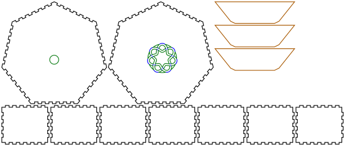

# Kalimba

**[← All projects](https://gernreich.github.io/)**

**[Read the writeup](https://gernreich.github.io/kalimba/)**

**[Turn it in 3D](https://gernreich.github.io/kalimba/kalimba-3d.html)**

A seven-sided kalimba body whose front carries a seven-fold knot rosette. Output is
millimetre-true — `1 user unit = 1 mm` with a physical `width`/`height` — so it prints
and cuts at real size.

<table>
<tr>
<td align="center"><a href="KalimbaSeptaBox.svg"></a></td>
</tr>
<tr>
<td align="center"><sub>KalimbaSeptaBox.svg · 578 × 245 mm sheet</sub></td>
</tr>
</table>

*Click it to download the cut file. This is a display rendering — the cut file draws a
hairline on no background, which a browser shows almost invisibly. Green, orange and cyan are darkened in the picture — at full strength they are too pale to read against a light ground. The cut file keeps the exact values.*

Built for **[LaserMadeMusic](https://www.youtube.com/@LaserMadeMusic)**, where the cutting
and assembly are shown.

**[The rest of the build files](https://gernreich.github.io/lasermademusic.html)** — every instrument,
generator and tool, indexed.

**[Download everything as a ZIP](https://github.com/Gernreich/kalimba/archive/refs/heads/main.zip)**

## What is on the sheet

Measured out of the file, not copied from whatever drew it:

Run the colours **blue, green, orange, black** — engrave first, then cut from the detail
outward to the outlines. That is the sequence every LaserMadeMusic repository uses: blue
engraves, then green → orange → cyan → black, black always the cut that frees the part.
This sheet has no cyan stage.

| | Colour | Part | Count | Size |
|---|---|---|---|---|
| 1 | blue `#0000ff` | rosette interlace and rim lines | 1 | 49.5 mm band |
| 2 | green `#00ff00` | the rosette | 1 | 48 mm across |
| 2 | green `#00ff00` | round hole in the plain face | 1 | 15 mm |
| 3 | orange `#ff8000` | stiffeners | 3 | 133.3 × 36.4 mm each |
| 4 | black `#000000` | two faces and seven sides | 9 | faces 175.6 × 171.2 mm, sides 79.1 × 65.1 mm |

Seven sides, two faces, and a rosette that is a septafoil — one ribbon crossing itself
seven times, so the hole echoes the plan of the box.

**The blue is an engrave, not a cut.** Those lines run across the ribbon; cutting them
severs it and the rosette comes apart as it leaves the machine. Give them a score or
engrave operation, or delete the layer. Outlines go last so nothing moves once a cut
frees it.

**The three orange stiffeners are optional.** They glue under the top sheet of the
heptagon to stiffen it — worth having, since that face has the rosette cut out of it —
but the build stands up without them. Skip the orange stage if you do not want them.

## The rosette

A cut-out: the removed material is the open area and the ribbon is what stays. Its peaks
overrun the rim so the rosette fuses into the face instead of dropping out when the last
cut closes — there is deliberately no continuous rim circle, and adding one drops it on
the floor. **[knotwork-soundholes](https://gernreich.github.io/knotwork-soundholes/)**
documents the family and generates any coprime leads × bights, if you want a different
fold count for a differently sided box.

## Before you cut

**Cut it in 3 mm Baltic birch plywood** — that is what this is built in, and what the
finger joints are sized for. Too thin and they rattle; too thick and they will not go
together, so substituting a different stock means regenerating the joints for it.
`kalimba.rs` regenerates them for other stock: `--ply=`, below. The faces and walls
carry a 0.14 mm kerf (their outlines grown 0.07 mm, round at the outside corners); if
the fit comes out loose or tight, recut at your laser's kerf with `--kerf=` (the house
measure is 0.13 mm).

**No acoustic claim is made.** The tines, bridge and tuning are not in this file — it is
the body only.

## Changing it

`kalimba.rs` draws the sheet from a few numbers. Build it with `cargo build --release`
(it expects the lasermade-tools and knotwork-soundholes checkouts beside this one), then
give it any of them as flags — a dash for each underscore; `--params` prints this table:

```
target/release/kalimba --ply=4 --kerf=0.13
```

PARAMS

The box is the one **[Boxes.py](https://github.com/florianfesti/boxes)**'s `RegularBox`
generator drew for this sheet (radius 90 outside, seven sides, h=65 outside, finger and
space twice the ply, burn 0.07), worked out again from the same rules: the faces are the
outside heptagon with a slot under every wall finger, and each wall stands on one edge,
its fingers counted along the inside edge, one end fingered and the other cut back with
slots for the next wall's. At the defaults every outline lies on Boxes.py's own to
within 0.05 mm². The rosette is knotwork-soundholes' 2-lead knot with a bight for every
side, read from its 30 mm cut file, scaled to `rosette_d` and turned so a bight points at
every corner; the drawn one was the same file scaled by hand, a little skewed. `sides`
must be odd, since a 2-lead knot needs an odd number of bights to be one strand. The
stiffeners are slices of the inside heptagon, as the drawn ones were to a tenth of a
millimetre.

Every run prints a validation block and exits non-zero if a check fails.

## SolidCraft design and STEP file

`kalimba --solidcraft=DIR` writes the box as a parametric SolidCraft design, assembled:
the plain face on the bench, the seven walls on its edges, the rosette face on top, one
body each. Every parameter except the kerf and the stiffeners is a parameter of the
design and every point is written from them. The kerf is not in it (it is the parts as
they come off the laser), nor are the stiffeners (where they go is drawn nowhere); the
number of sides is read-only. The finger counts follow the sizes: `nb` (along a wall's
top and bottom) is `floor(side0/(fw + sw))` and `nl` (up its ends) `floor(wall_l/(fw +
sw))`, as Boxes.py counts them, and each wall is its plain body with one finger top and
bottom and one corner finger or slot at each end, patterned that many times; each face
is the plain heptagon with one slot per edge, patterned the same way. Lengthen the box
and the fingers fill the new length. SolidCraft builds the `.sc` and STEP files from it, and `.repro` checks all three:

```
solidcraft-cli run solidcraft/kalimba-septa-box.solidcraft.json --save solidcraft/kalimba-septa-box.sc --out step/kalimba-septa-box.step
```

- `solidcraft/kalimba-septa-box.solidcraft.json`
- `solidcraft/kalimba-septa-box.sc`
- `step/kalimba-septa-box.step`

Checked against the generator body by body: at the defaults, identical to the design
whose outlines were written point by point; and set to a 200 mm radius and a 150 mm
height (14 fingers along, 12 up, where the defaults have 6 and 4), every volume within
4e-7 of the cut sheet the generator draws at those sizes. Neighbouring walls overlap at
the inside of each corner, 37 mm³ at the defaults and more with more fingers up the end:
RegularBox's angled finger joint as drawn. The fingers and the faces' slots do not
overlap.

## Files

| | |
|---|---|
| `KalimbaSeptaBox.svg` | the whole body — seven sides, two faces, rosette |
| `previews/` | display rendering — **not** a cut file |
| `kalimba.rs` | draws `KalimbaSeptaBox.svg` and writes the SolidCraft design: `target/release/kalimba` |
| `solidcraft/` | the SolidCraft design and the `.sc` file built from it |
| `step/` | the STEP file built from the design |
| `kalimba-3d.html` | the 3D view, assembled from the cut files — drag to turn |
| `viewer.rs` | builds `kalimba-3d.html` from the cut files, with the turn3d module in lasermade-tools: `cargo build --release`, then `target/release/viewer` |
| `Cargo.toml` · `Cargo.lock` | the Rust package for `kalimba.rs` and `viewer.rs`; it expects the lasermade-tools and knotwork-soundholes checkouts beside this one |
| `.repro` | how every shipped drawing and page is reproduced |
| `index.md` · `index.html` | the published page; the markdown is the source |

Released under [CC0 1.0](LICENSE). **Boxes.py is Florian Festi's and is
GPL-3.0-or-later** — `kalimba.rs` follows its geometry, and none of its code is in this
repository.

## Credits

Made by Michael Gernreich with [Claude](https://www.anthropic.com/claude) (Anthropic), working in Claude Code, which co-wrote the code and the documentation. Commits Claude made carry a `Co-Authored-By: Claude` line.
