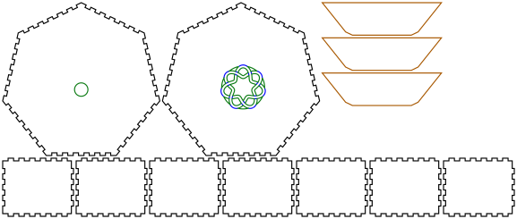

# Kalimba — a seven-sided body with a septafoil rosette

**[← All projects](https://gernreich.github.io/)**

**[Read the README](https://github.com/Gernreich/kalimba)**

**[Turn it in 3D](https://gernreich.github.io/kalimba/kalimba-3d.html)**

<iframe src="kalimba-3d.html?embed" title="The kalimba body as solid parts you can drag to turn and pull apart: the plain face with its round hole underneath, seven finger-jointed walls, and the septafoil rosette face on top" style="width:100%;height:560px;border:0"></iframe>

A kalimba is a lamellophone: tuned metal tines fixed over a bridge on a resonating
body, plucked with the thumbs. This repository holds the **body** — a seven-sided box
whose front carries a seven-fold knot rosette.

Seven and seven is the whole idea. The box has seven sides, and the rosette is a
septafoil: one continuous ribbon crossing itself seven times, so the sound hole echoes
the plan of the thing it is cut into.

**The tines, bridge and tuning are not here.** Nothing in this file is an instrument on
its own.

## Get the files

- **[Download the cut file](KalimbaSeptaBox.svg)** — the whole body on one sheet.
- **[Everything as a ZIP](https://github.com/Gernreich/kalimba/archive/refs/heads/main.zip)**
  — the cut file and this writeup.
- **[Repository](https://github.com/Gernreich/kalimba)** — if you want to change the box
  or the rosette.

Released under CC0 1.0 — do what you like with them, no attribution needed. The box
is the one **[Boxes.py](https://github.com/florianfesti/boxes)**'s `RegularBox`
generator draws (Boxes.py is Florian Festi's, and GPL-3.0-or-later); `kalimba.rs`
works its geometry out again from the same rules, and no Boxes.py code is in this
repository. Built for
**[LaserMadeMusic](https://www.youtube.com/@LaserMadeMusic)**.

**[The rest of the build files](https://gernreich.github.io/lasermademusic.html)** — every instrument,
generator and tool, indexed.

## The sheet

Click the picture to download the cut file. It is a display rendering — the cut file
draws a hairline on no background at all, which a browser shows almost invisibly, so
this is thickened and painted onto a light ground. Geometry and sheet position are
untouched. The three lightest cut-order inks — green, orange and cyan — are darkened in these pictures. At full strength they fall below the contrast a light background can carry, so the cut order could not be read off them. Hue and sequence are unchanged, and the cut files keep the exact values.

<div class="tw">
<table>
<tr>
<td align="center"><a href="KalimbaSeptaBox.svg"></a></td>
</tr>
<tr>
<td align="center"><sub>KalimbaSeptaBox.svg · 578 × 245 mm sheet</sub></td>
</tr>
</table>
</div>

## What is on it

Measured out of the file, not copied from whatever drew it:

| | Colour | Part | Count | Size |
|---|---|---|---|---|
| 1 | **blue `#0000ff`** | rosette interlace and rim lines | 1 | 49.5 mm band |
| 2 | **green `#00ff00`** | the rosette | 1 | 48 mm across |
| 2 | **green `#00ff00`** | round hole in the plain face | 1 | 15 mm |
| 3 | **orange `#ff8000`** | stiffeners | 3 | 133.3 × 36.4 mm each |
| 4 | **black `#000000`** | face with the rosette | 1 | 175.6 × 171.2 mm |
| 4 | **black `#000000`** | face with the round hole | 1 | 175.6 × 171.2 mm |
| 4 | **black `#000000`** | side panels, finger-jointed | 7 | 79.1 × 65.1 mm each |

Sizes are the cut path itself, not its drawn outline — the path is what the laser
follows. Seven sides, two faces. The sheet is 578 × 245 mm, with 3 mm round and between
the parts, and millimetre-true — `1 user unit = 1 mm` with a physical `width`/`height`
— so it prints and cuts at real size. The faces and walls carry a 0.14 mm kerf: their
outlines are grown by 0.07 mm, round at the outside corners, so the joints press-fit
once the laser has taken its line. The holes, the rosette and the stiffeners are drawn
true; none of them is a fit.

### Colour is the order, and blue is not a cut

Run them **blue, green, orange, black** — engrave first, then cut outward from the
detail to the outlines. Outlines last is the usual reason: once a cut frees a part,
anything still to be cut inside it can move.

That sequence is shared by every LaserMadeMusic repository: blue engraves, then
green → orange → cyan → black, with black always the cut that frees the part and violet
meaning skip. This sheet uses four of the five — there is no cyan stage and nothing to
skip.

**The blue is an engrave.** Those lines are the rosette's over/under interlace hints and
the short continuations carrying the ribbon's edges across the rim. They run across the
ribbon, so cutting them severs it and the rosette comes apart as it leaves the machine.
Give them a score or engrave operation, or delete the layer.

Give every colour you keep an explicit operation. A per-colour job silently skips any
colour you leave unmapped — leave the black unmapped and you will engrave a rosette and
cut no parts.

### The three orange stiffeners are optional

They glue underneath the top sheet of the heptagon to stiffen it, and the build stands
up without them. Each is a slice of the box's inside heptagon, 36.4 mm deep from the
wall it sits against, with that wall's two corners cut back 4.7 mm to clear the joints. Cut them if you want the face stronger — worth considering, since that
face has the rosette cut out of it — and skip the orange stage entirely if you do not.

## The rosette

One self-crossing ribbon with seven crossings, 48 mm across: the 2-lead 7-bight knot
from knotwork-soundholes, its 60 mm cut file scaled to 48, turned so a bight points at
every corner of the face, and set 5.5 mm off the face's centre towards one corner. It is a **cut-out**: the
removed material is the open area and the ribbon is what stays, and the ribbon's peaks
deliberately overrun the rim so the rosette fuses into the face rather than dropping out
when the last cut closes. There is no continuous rim circle in the cut layer, and that is
correct — adding one drops the rosette on the floor.

**[The knotwork sound holes repository](https://gernreich.github.io/knotwork-soundholes/)**
documents this family in full and generates any coprime leads × bights, if you want a
different fold count for a differently sided box.

## Before you cut

**Cut it in 3 mm Baltic birch plywood.** That is what this is built in, and it is what
the finger joints are sized for. Finger joints do not tolerate being cut in stock they
were not sized for — too thin and they rattle, too thick and they will not go together —
so if you substitute anything else, regenerate the sheet for it rather than scaling it:
`--ply=` in the next section. If the fit comes out loose or tight on your laser, recut at
its real kerf with `--kerf=` (the house measure is 0.13 mm; this sheet was cut at 0.14).

**No acoustic claim is made.** A kalimba body is a resonator; how it sounds depends on
how well the box closes and on the tines, neither of which these files decide.

**The rosette removes a good half of its disc** from a face that also has to hold the box
square. Consider that before choosing a thin material.

## Changing it

`kalimba.rs` draws the sheet from a few numbers. Build it with `cargo build --release`
(it expects the lasermade-tools and knotwork-soundholes checkouts beside this one), then
give it any of them as flags — a dash for each underscore:

```
target/release/kalimba --ply=4 --kerf=0.13
```

| parameter | default | what it is |
|---|---|---|
| `ply` | 3 mm | the ply |
| `radius` | 90 mm | the box's outside corner radius |
| `height` | 65 mm | the box's outside height, face to face |
| `sides` | 7 | sides of the box, and bights of the rosette; read only in the design |
| `finger` | 2 | a finger's width, in plies |
| `space` | 2 | the space between fingers, in plies |
| `kerf` | 0.14 mm | the laser's kerf: the box's outlines grow by half of it; not in the design |
| `rosette_d` | 48 mm | the rosette's rim, across |
| `rosette_offset` | 5.5 mm | the rosette's centre from the face's, towards a corner |
| `hole_d` | 15 mm | the plain face's round hole |
| `hole_offset` | 7.3 mm | the hole's centre from the face's, towards an edge |
| `stiffeners` | 3 | stiffeners on the sheet |
| `stiffener_depth` | 36.4 mm | a stiffener, from the wall it sits against to its long edge |
| `stiffener_corner` | 4.7 mm | how far each of its two wall-side corners is cut back, along each side |

The box is `RegularBox`'s geometry: the faces are the outside heptagon with a slot under
every wall finger, and each wall stands on one edge with its fingers counted along the
inside edge, `finger` and `space` plies wide, and its ends jointed for the corner — one
end fingered, the other cut back with slots for the next wall's fingers. At the
defaults every outline lies on Boxes.py's own to within 0.05 mm². `sides` must be odd:
the rosette has a bight for every side, and a 2-lead knot needs an odd number of
bights to be one strand. knotwork-soundholes ships the 3, 5 and 7.

Every run prints a validation block — fingers on every edge, the rosette and the hole
clear of the walls, the rosette's openings counted, the stiffener's shape, the sheet
fitting the 600 × 305 mm bed — and exits non-zero if any check fails.

## SolidCraft design and STEP file

`kalimba --solidcraft=DIR` writes the box as a parametric SolidCraft design, assembled:
the plain face on the bench, the seven walls on its edges, the rosette face on top, one
body each. Every parameter above except the kerf and the stiffeners is a parameter of
the design, and every point of every part is written from them, so changing `ply`,
`radius`, `height`, `finger`, `space` or the rosette's and hole's sizes and places in
SolidCraft moves the parts with them. The design is the parts as they come off the
laser, so the kerf is not in it, and the stiffeners are not either: where they go is
drawn nowhere. The number of sides and the finger counts (`nb`, `nl`) stay as the
defaults made them, and the design says so in read-only parameters: a change that would
give an edge a finger more or fewer needs the generator.

- `solidcraft/kalimba-septa-box.solidcraft.json` — the design, as SolidCraft's commands
- `solidcraft/kalimba-septa-box.sc` — SolidCraft's own file, built from it
- `step/kalimba-septa-box.step` — the solids as STEP, for any CAD program, built from it

```
solidcraft-cli run solidcraft/kalimba-septa-box.solidcraft.json --save solidcraft/kalimba-septa-box.sc --out step/kalimba-septa-box.step
```

Checked against the generator body by body, at the defaults and with eight parameters
moved, every volume within 2e-6. Each pair of neighbouring walls overlaps by 37 mm³ at
the inside of their corner, 0.63 mm² over the wall's height: that is RegularBox's
angled finger joint as drawn, and the faces' slots and the walls' fingers do not
overlap at all.

## Files

| | |
|---|---|
| `KalimbaSeptaBox.svg` | the whole body — seven sides, two faces, rosette |
| `previews/` | display rendering — **not** a cut file |
| `kalimba.rs` | draws `KalimbaSeptaBox.svg` and writes the SolidCraft design: `target/release/kalimba` |
| `solidcraft/` | the SolidCraft design and the `.sc` file built from it |
| `step/` | the STEP file built from the design |
| `kalimba-3d.html` | the 3D view, assembled from the cut files — drag to turn |
| `viewer.rs` | builds `kalimba-3d.html` from the cut files, with the turn3d module in lasermade-tools: `cargo build --release`, then `target/release/viewer` |
| `Cargo.toml` · `Cargo.lock` | the Rust package for `kalimba.rs` and `viewer.rs`; it expects the lasermade-tools and knotwork-soundholes checkouts beside this one |
| `.repro` | how every shipped drawing and page is reproduced |
| `index.md` · `index.html` | this page; the markdown is the source |

## Credits

Made by Michael Gernreich with [Claude](https://www.anthropic.com/claude) (Anthropic), working in Claude Code, which co-wrote the code and the documentation. Commits Claude made carry a `Co-Authored-By: Claude` line.
